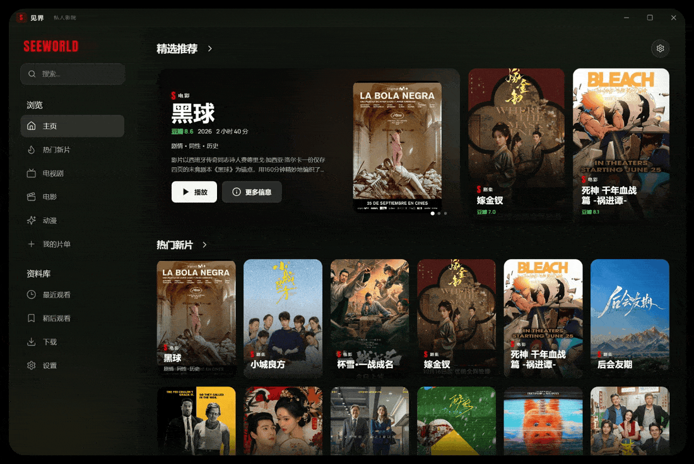

<div align="center">
  
  <h1>SEEWORLD · 见界</h1>
  <p><strong>见世界，见边界。</strong><br />
  安静、私密的 Windows 私人影院</p>
</div>



<p align="center"><sub>发现 · 无限瀑布流 · 搜索 · 详情 · 1080P 播放 · 设置</sub></p>

见界把「找片」和「看片」放进同一块暗色界面：豆瓣负责发现与元数据，多个公开影视 CMS 源提供片源，Rust 代理负责取流、过滤与断点续播。没有账号，打开即看。

## 特性

- **发现** — 豆瓣实时榜单、分类筛选与联想搜索；首页提供精选推荐与热门新片，剧集、电影、动漫各有分类页。分类页是无限瀑布流，触底自动续载，并可一键回到顶部。
- **一处片库** — 豆瓣条目与播放源命中统一注册为 `Title`。详情、续看、我的片单与最近观看共用同一份片库，不因来源不同而割裂。
- **播放即最优** — 多线路并发探测，按速度、稳定性与画质选线，MP4 直链和 H.264 优先；启动无帧、单次冻结 60 秒或 5 分钟内频繁卡顿时，自动换线换源。播放器支持 0.75×–2× 倍速，续播时明确提示从哪一刻接上。
- **干净的画面** — `jjstream` 代理按线路过滤 HLS 广告分片，支持分片时长指纹、关键词与目录特征；大文件 MP4 以 16 MB Range 分段回源。内嵌在正片画面里的广告无法从播放列表剔除，不在过滤范围内。
- **只属于本机** — 无账号、无云端同步。片单、进度与偏好只存本机，设置页可分别清空观看记录、片单与缓存；界面支持中文 / English 双语。单实例运行，窗口大小与位置自动记忆。

## 工作方式

`豆瓣发现 → Title 注册 → 多源检索 → 线路探测 → jjstream 代理 → hls.js / HTML5 播放`

1. **发现** — 豆瓣列表、详情与搜索经 Rust 命令取回，统一适配为 `Title` 并写入前端片库注册表。
2. **取流** — 各 CMS 源并发搜索，拉取详情与全部线路，按速度、稳定性、画质探测出可播线路。
3. **播放** — HLS / MP4 经 `jjstream` 代理过滤广告分片、按需分段回源，再交给 hls.js 播放；进度写回本地。

## 技术栈

| 层 | 选型 | 职责 |
| :--- | :--- | :--- |
| 桌面壳 | Tauri 2 · Rust | 原生窗口、命令调用、`dbimg://` 与 `jjstream://` 协议 |
| 界面 | React 19 · TypeScript · Vite | 视图状态机、海报流、双语与本地持久化 |
| 播放 | hls.js · HTML5 Video | HLS / MP4 统一播放、进度与自动换源 |
| 数据 | 豆瓣 · 影视 CMS | 元数据与播放源 |
| 代理 | Rust · reqwest | 防盗链图片、流代理、广告过滤与 Range 回源 |

前端不使用路由，`App.tsx` 按 `ViewKey` 条件渲染视图；后端按数据域拆分为 `douban`、`play`、`play_proxy` 三个模块。片库、播放源命中与列表均有本地缓存，重复打开不必重新等待网络。

## 开始

需要 Windows 10 / 11、Node.js 20+、Rust 1.90+（仓库通过 `rust-toolchain.toml` 固定 1.94.0）与 WebView2 Runtime（Windows 11 已内置）。

```bash
# 安装依赖
npm install
npm --prefix prototype install

# 启动开发环境（Tauri + Vite，热更新）
npm run dev

# 前端类型检查与构建
npm --prefix prototype run build

# Rust 检查（在 src-tauri 目录执行）
cargo check

# 构建免安装可执行文件
npm run build:exe
```

## 配置

- 播放源注册表位于 `src-tauri/resources/play-sources.json`，内置 7 个公开影视 CMS 源（默认启用 6 个）。
- 在 `%APPDATA%\com.jianjie.desktop\play-sources.json` 放置同名文件即可覆盖内置配置，无需改代码。
- 豆瓣海报与剧照统一走 `dbimg://` 代理并附带 Referer，避免豆瓣图片防盗链失效；播放源自带的海报按源域名加载（CSP 已放行 http/https 图片）。
- 本地数据使用 `jj-` 前缀的 localStorage 键；删除对应键即可重置列表缓存、片库缓存或播放进度。

## 项目结构

```text
.
├─ prototype/                 React 19 + Vite 界面
│  ├─ src/components/         首页、分类、搜索、详情、Theater 等视图
│  ├─ src/player/             hls.js 播放、自动换源与进度
│  ├─ src/douban.ts           豆瓣数据与 Title 适配
│  └─ src/play.ts             播放源命令封装
├─ src-tauri/
│  ├─ src/douban.rs           豆瓣接口与图片代理
│  ├─ src/play.rs             CMS 搜索、详情与线路探测
│  ├─ src/play_proxy.rs       jjstream 流代理与广告过滤
│  └─ resources/              播放源注册表
└─ docs/assets/               品牌标志与全流程演示
```

## 说明

- 仅支持 Windows 10 / 11；首次启动依赖 WebView2 Runtime。
- 本项目不提供、不存储、不分发任何影视内容。元数据来自豆瓣，播放地址由第三方公开接口提供，可用性取决于源站。
- 广告过滤只作用于可识别的 HLS 广告分片；源站改版或更换广告形式时可能需要更新线路规则。
- 代码仅供个人学习与技术研究，请支持正版。仓库暂未附带开源许可证。

## 致谢

[Tauri](https://tauri.app) · [React](https://react.dev) · [hls.js](https://github.com/video-dev/hls.js) · [豆瓣](https://www.douban.com) 及所有公开数据源。

<div align="center"><sub>SEEWORLD — 见世界，见边界。</sub></div>
